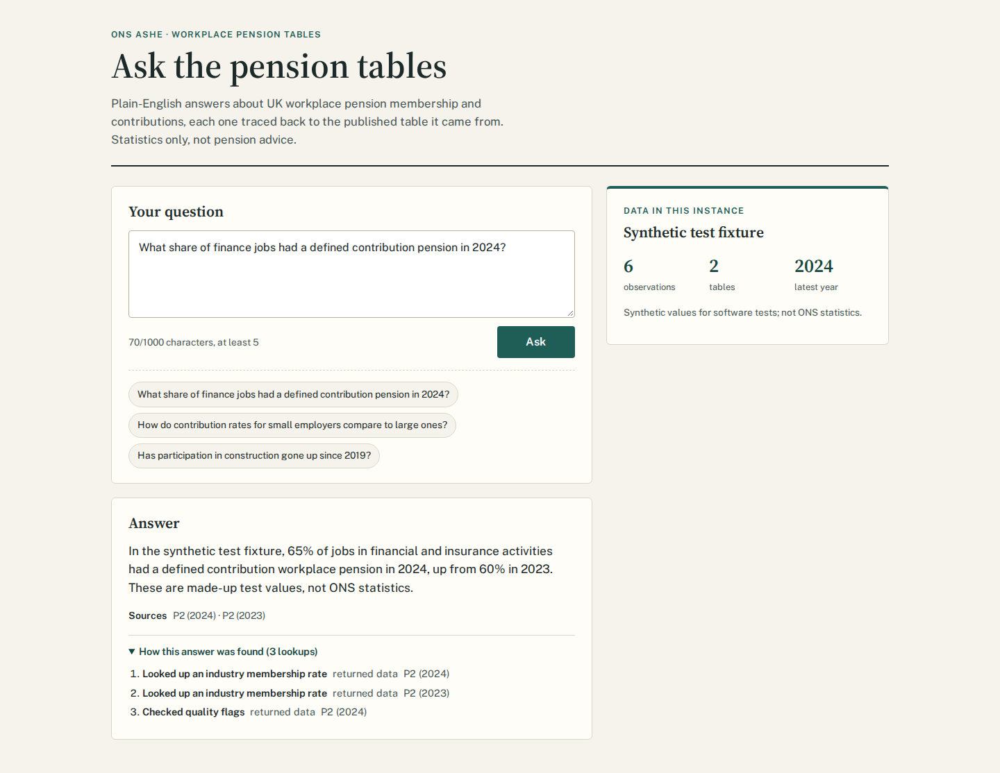
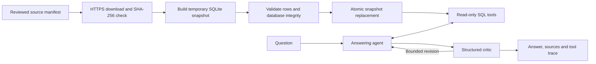

# Ask the ASHE workplace pensions tables

A small research assistant for exploring UK workplace pension statistics. It pairs
read-only SQL tools with a LangGraph answering/critic loop, so every answer comes back
with the tables it cites and the tool lookups behind it. The data is a local annual
snapshot; a question never triggers a background download.

The useful engineering problem here is keeping three things separate: reproducible
source data, model-generated explanations, and the workflow that refreshes a snapshot.
A model key is optional for inspecting the dataset and running the offline tests.



The screenshot uses the six-row **synthetic fixture** and a recorded answer, because
no model key is used to produce documentation.

## Quick start with Docker Compose

```bash
cp .env.example .env            # leave OPENAI_API_KEY empty to explore without a model
docker compose up -d --build
docker compose exec api python -m scripts.build_dataset --manifest sources/fixture.json
```

Open http://localhost:5173 for the UI and http://localhost:8000/docs for the API explorer.
The fixture build is offline and creates six synthetic observations; they are test data,
not ONS statistics, and the UI labels them as such. To load the real snapshot instead,
use `--manifest sources/ons.json` (see below). `docker compose down -v` removes the
containers and the snapshot volume.

## Native setup

Use Python 3.12 and Node 22 (`.python-version`, `ui/.nvmrc`). From the repository root:

```bash
python3.12 -m venv .venv
source .venv/bin/activate
pip install -r requirements.txt
cp .env.example .env
python -m scripts.build_dataset --manifest sources/ons.json --database data/ashe.db
python -m uvicorn src.api.server:app --host 127.0.0.1 --port 8000
```

The ONS build downloads 152 checksum-pinned ONS archives and can take several
minutes. Later builds reuse the verified download cache. The database is generated
locally; it is **not included in a fresh checkout**. Swap in `sources/fixture.json`
for the offline fixture.

In a second terminal:

```bash
cd ui
cp .env.example .env
npm ci
npm run dev
```

Open the address Vite prints, normally http://localhost:5173. `/health` checks the
process; `/ready` checks the dataset and reports whether the model is configured.

Set `OPENAI_API_KEY` in `.env` to enable answers. Model calls incur provider usage;
the dataset build and offline tests do not call a model. This is a local demonstration:
add user authentication, quotas and a deployment boundary before exposing the
question endpoint publicly.

## The API

| Method and path | Purpose |
| --- | --- |
| `GET /health` | Process liveness |
| `GET /ready` | Snapshot version, mode, row count, tables, years and `agent_configured`; 503 until a snapshot exists |
| `POST /api/ask` | `{"question": "..."}` (5 to 1,000 characters) returns `answer`, `sources`, `tool_calls` and the `critic` verdict |
| `GET /admin/source-status` | Bearer `ASHE_REFRESH_TOKEN`; compares the approved manifest with the live snapshot |
| `POST /admin/refresh` | Bearer `ASHE_REFRESH_TOKEN`; builds and atomically promotes a new snapshot |

Responses captured from the Compose stack with the fixture snapshot and no model key:

```console
$ curl -s localhost:8000/ready
{"ready":true,"rows":6,"tables":["P12","P2"],"years":[2023,2024],"version":"synthetic-fixture-v1",
 "mode":"fixture","manifest_sha256":"0e5284c7…e864d","built_at":"2026-11-09T12:01:46.328146+00:00",
 "notice":"Synthetic values for software tests; not ONS statistics.","agent_configured":false}

$ curl -s -X POST localhost:8000/api/ask -H 'Content-Type: application/json' \
    -d '{"question":"What share of finance jobs had a DC pension in 2024?"}'
{"detail":"Dataset is available, but the model provider is not configured."}     # HTTP 503

$ curl -s -X POST localhost:8000/admin/refresh
{"detail":"Dataset refresh authorization required"}                              # HTTP 401
```

With a key configured, `/api/ask` answers in this shape (values from the fixture):

```json
{
  "answer": "In 2024, 65% of jobs in financial and insurance activities had a defined contribution pension …",
  "sources": ["P2 (2024)"],
  "tool_calls": [{"tool": "lookup_industry_membership_rate",
                  "arguments": {"industry_hint": "finance", "year": 2024}, "ok": true,
                  "result": {"industry": "Financial and insurance activities", "year": 2024,
                             "pension_family": "defined contribution", "percent": 65.0},
                  "sources": ["P2 (2024)"], "error": null}],
  "critic": {"grounded": true, "advice_free": true, "clear_for_hr_reader": true, "issues": []}
}
```

Browser access is limited to the origins in `ASHE_CORS_ORIGINS` (the Vite dev and
Compose web origins by default).

## What is actually in the snapshot?

The approved manifest covers P1, P2 and P4–P12, with 245,858 normalized observations
in the verified build. Years available are **2009–2021 and 2024**. This is not a
continuous 2009–2024 series: the public P-table coverage for 2022/2023 is missing.
Only the selected `All` population files are loaded; gender-specific analysis is outside
this snapshot. Contribution methodology changes also limit comparisons across releases.

Consult the [ONS quality and methods guide](https://www.ons.gov.uk/employmentandlabourmarket/peopleinwork/workplacepensions/methodologies/employeeworkplacepensionsukqualityandmethodsguide)
and [release notes](https://www.ons.gov.uk/employmentandlabourmarket/peopleinwork/workplacepensions/bulletins/annualsurveyofhoursandearningspensiontables/2024provisionaland2021to2023finalresults)
before interpreting a trend. Suppression/quality flags remain attached to observations.
The assistant explains published statistics; it does not provide pension advice.



Failed builds leave the previous snapshot intact. A lock serializes concurrent
refreshes; downloads are size-limited, restricted to ONS HTTPS sources and checked
against the manifest. Adding a release requires reviewing its URLs/checksums and
committing a new manifest.

## Why the model cannot write to the data

The model never writes SQL. It chooses among seven typed tools (`src/agent/tools.py`)
whose arguments are human phrases such as `"finance sector"`, validated by pydantic
schemas and bound into fixed, parameterized queries. On top of that, each tool call:

- opens the snapshot with SQLite `mode=ro` and `PRAGMA query_only`, and closes it afterwards;
- installs an SQLite authorizer that allows only `SELECT`, table reads and ordinary functions,
  so writes, `ATTACH`, `PRAGMA` changes, `load_extension` and `VACUUM INTO` are refused;
- reads `ASHE_DB_PATH` from the server environment, never from model input.

`tests/test_tools.py` feeds injection-shaped hints (`'; DROP TABLE …`, `UNION SELECT`,
`ATTACH DATABASE`) through the tools and checks that the snapshot is byte-for-byte
unchanged and no file appears.

The critic is a second model call that judges groundedness, advice-free wording and
clarity as structured output. A failed verdict triggers at most one rewrite
(`AGENT_MAX_CRITIC_ATTEMPTS`, default 2 critic passes); if the critic itself fails, the
draft is returned with the error attached rather than blocking the answer.

## Scheduled refresh with n8n

Import [the workflow](workflows/ashe-refresh.json) into n8n. It runs manually or at
06:00 UTC daily, compares the approved manifest with the current snapshot, and refreshes
only when those versions differ. It **does not discover or automatically approve new
ONS releases**.

1. Generate a separate random `ASHE_REFRESH_TOKEN` and set it on the API process.
2. Create an n8n **Header Auth** credential named `ASHE refresh token`: header
   `Authorization`, value `Bearer <your token>`. Select it in both HTTP nodes.
3. Set the `API connection` node to the API address reachable from n8n. For the optional
   Compose automation service (`docker compose --profile automation up -d`) use
   `http://api:8000`, not container localhost.
4. Run manually and inspect the success/failure branch before activating the schedule.

The workflow retries transient HTTP failures and stops on a failed validation. Its
20-minute request timeout allows a cold download. Keep this admin API on a trusted
network; the credential belongs in n8n's credential store, never the workflow JSON.

[Execution evidence](docs/workflow-verification.json) records a real n8n 2.45.5 run:
initial fixture build, repeat/no-op, and checksum failure with the old database preserved.
That verifies orchestration, not hosted-model answer quality.

## Tests and checks

Everything below runs offline, without a model key:

```bash
pip install -r requirements-dev.txt
python -m pytest -q          # 56 tests
ruff check .
cd ui
npm test                     # 6 Vitest + Testing Library tests
npm run lint
npm run build
```

The Python suite covers snapshot building and failed-build preservation, every SQL
tool (including the refused statements above), the LangGraph loop driven by a scripted
model (tool dispatch, sources and trace, one bounded rewrite, the attempt cap, critic
outage), the API (validation, readiness, admin auth, CORS, error masking) and the
ingest helpers. The UI tests cover the loading, unreachable, missing-model, answer and
error states.

`evals/` contains a separate golden-question and LLM-judge harness. Run
`python evals/verify_golden_against_db.py` to check expected values against your
snapshot; `run_evals.py` and `llm_judge_check.py` require a provider key and make paid
calls. The construction trend expectation uses the pinned revised 2019 edition (70.8%);
its source/checksum is recorded alongside the golden case. Historical evaluation reports
are not evidence of a fresh run against a new snapshot. The critic can make mistakes,
questions have no cross-request conversation memory, and the small golden set does not
establish broad factual accuracy or load capacity.

## Where to extend it

`src/agent/tools.py` for retrieval, `src/agent/graph.py` for reasoning,
`src/datasets.py` for snapshot publication, and `sources/ons.json` for approved inputs.
Keeping those boundaries explicit makes it possible to test data correctness without
depending on model behavior.

## License

MIT, see [LICENSE](LICENSE). ONS source data is published under the
[Open Government Licence v3.0](https://www.nationalarchives.gov.uk/doc/open-government-licence/version/3/).
