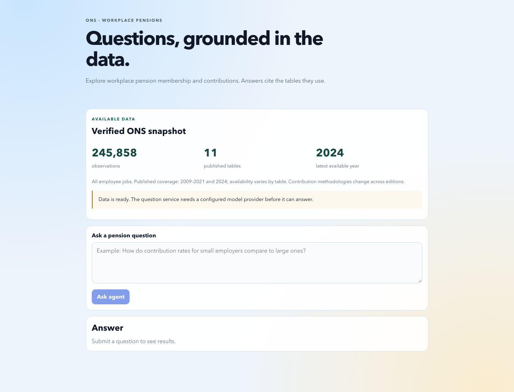
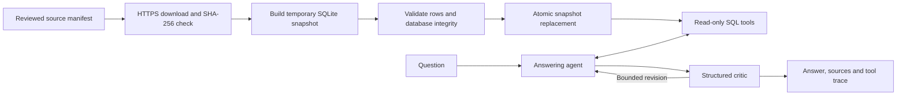

# Ask the ASHE workplace pensions tables

A small research assistant for exploring UK workplace pension statistics. It pairs
read-only SQL tools with a LangGraph answering/critic loop, so an answer can include
both its source tables and the tool trace behind it. The data is a local annual
snapshot; a question never triggers a background download.

The useful engineering problem here is keeping three things separate: reproducible
source data, model-generated explanations, and the workflow that refreshes a snapshot.
A model key is optional for inspecting the dataset and running the offline tests.



## Start with the data

Use Python 3.12 and Node 22. From the repository root:

```bash
python3.12 -m venv .venv
source .venv/bin/activate
pip install -r requirements.txt
cp .env.example .env
python -m scripts.build_dataset --manifest sources/ons.json --database data/ashe.db
python -m uvicorn src.api.server:app --host 127.0.0.1 --port 8000
```

The first build downloads 152 checksum-pinned ONS archives and can take several
minutes. Subsequent builds reuse the verified download cache. The database is generated
locally; it is **not included in a fresh checkout**.

For a quick, fully offline demonstration, replace `sources/ons.json` with
`sources/fixture.json` in the build command. That creates six **synthetic** observations;
they are test data, not ONS statistics. The UI labels the fixture explicitly.

In a second terminal:

```bash
cd ui
cp .env.example .env
npm ci
npm run dev
```

Open the address Vite prints, normally http://localhost:5173. `/docs` on port 8000
provides the request/response explorer. `/health` checks the process; `/ready` checks
the dataset and reports whether the model is configured. Asking a question returns
503 when the dataset or model configuration is missing, rather than inventing an answer.

Set `OPENAI_API_KEY` in `.env` to enable answers. Model calls incur provider usage;
the dataset build and offline tests do not call a model. This is a local demonstration:
add user authentication, quotas, restricted CORS and a deployment boundary before
exposing the question endpoint publicly.

## What is actually in the snapshot?

The approved manifest covers P1, P2 and P4–P12, with 245,858 normalized observations
in the verified build. Years available are **2009–2021 and 2024**. This is not a
continuous 2009–2024 series: the public P-table coverage for 2022/2023 is missing.
Only the selected `All` population files are loaded; gender-specific analysis is outside
this snapshot. Contribution methodology changes also limit comparisons across releases.

Consult the [ONS quality and methods guide](https://www.ons.gov.uk/employmentandlabourmarket/peopleinwork/workplacepensions/methodologies/employeeworkplacepensionsukqualityandmethodsguide)
and [release notes](https://www.ons.gov.uk/employmentandlabourmarket/peopleinwork/workplacepensions/bulletins/annualsurveyofhoursandearningspensiontables/2024provisionaland2021to2023finalresults)
before interpreting a trend. Suppression/quality flags remain attached to observations.
The assistant explains published statistics; it does not provide pension advice.



Tool connections use SQLite read-only mode and close after each call. Failed builds
leave the previous snapshot intact. A lock serializes concurrent refreshes; downloads
are size-limited, restricted to ONS HTTPS sources and checked against the manifest.
Adding a release requires reviewing its URLs/checksums and committing a new manifest.

## Scheduled refresh with n8n

Import [the workflow](workflows/ashe-refresh.json) into n8n. It runs manually or at
06:00 UTC daily, compares the approved manifest with the current snapshot, and refreshes
only when those versions differ. It **does not discover or automatically approve new
ONS releases**.

1. Generate a separate random `ASHE_REFRESH_TOKEN` and set it on the API process.
2. Create an n8n **Header Auth** credential named `ASHE refresh token`: header
   `Authorization`, value `Bearer <your token>`. Select it in both HTTP nodes.
3. Set the `API connection` node to the API address reachable from n8n. For the optional
   Compose automation service use `http://api:8000`, not container localhost.
4. Run manually and inspect the success/failure branch before activating the schedule.

The workflow retries transient HTTP failures and stops on a failed validation. Its
20-minute request timeout allows a cold download. Keep this admin API on a trusted
network; the credential belongs in n8n's credential store, never the workflow JSON.

[Execution evidence](docs/workflow-verification.json) records a real n8n 2.45.5 run:
initial fixture build, repeat/no-op, and checksum failure with the old database preserved.
That verifies orchestration, not hosted-model answer quality.

Optional container definitions include API/UI and an `automation` n8n profile. Set the
environment values, run `docker compose up --build`, then build the snapshot with
`docker compose exec api python -m scripts.build_dataset --manifest sources/ons.json`.
The native setup above was exercised; container startup has not been verified.

## Checks and boundaries

```bash
pip install -r requirements-dev.txt
python -m pytest -q tests
cd ui
npm run lint
npm run build
```

Offline regressions cover snapshot creation, read-only queries, missing-dataset readiness,
refresh authentication and failed-build preservation. The browser build and lint checks
also run without credentials.

`evals/` contains a separate golden-question and LLM-judge harness. Run
`python evals/verify_golden_against_db.py` to check expected values against your snapshot;
`run_evals.py` and `llm_judge_check.py` require a provider key and make paid calls.
The construction trend expectation uses the pinned revised 2019 edition (70.8%); its
source/checksum is recorded alongside the golden case. Historical evaluation reports are not evidence of a fresh run against a new snapshot.
The critic can make mistakes, questions have no cross-request conversation memory,
and the small golden set does not establish broad factual accuracy or load capacity.

The main extension points are `src/agent/tools.py` for retrieval, `src/agent/graph.py`
for reasoning, `src/datasets.py` for snapshot publication, and `sources/ons.json` for
approved inputs. Keeping those boundaries explicit makes it possible to test data
correctness without depending on model behavior.

## Author

[**Muhammad Nadeem**](https://github.com/dev-mnadeem)
